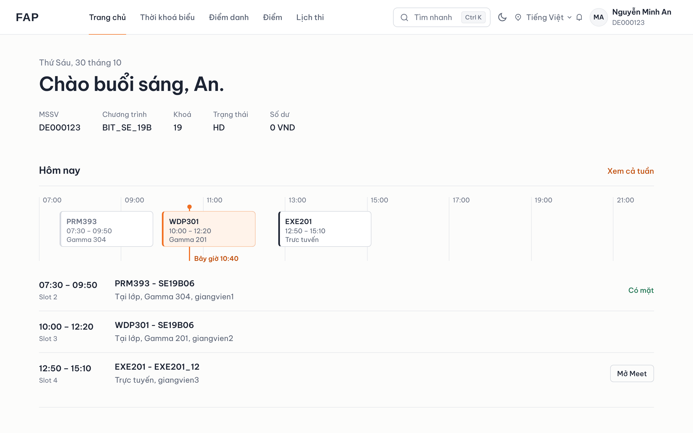
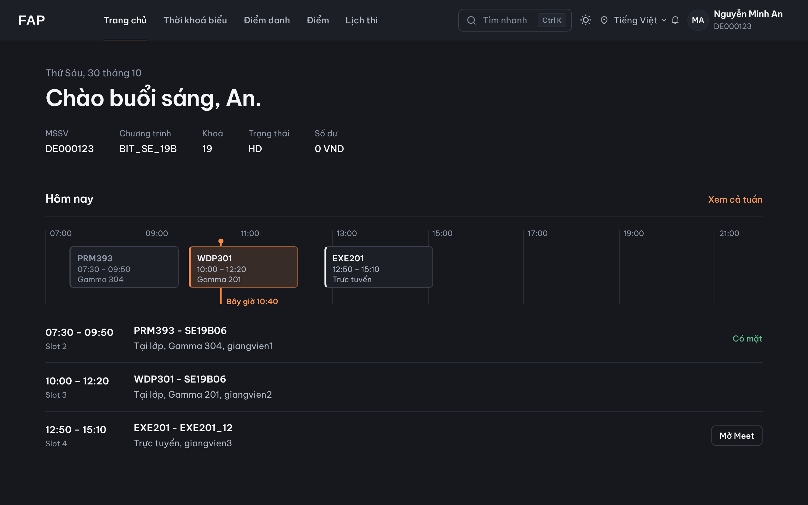
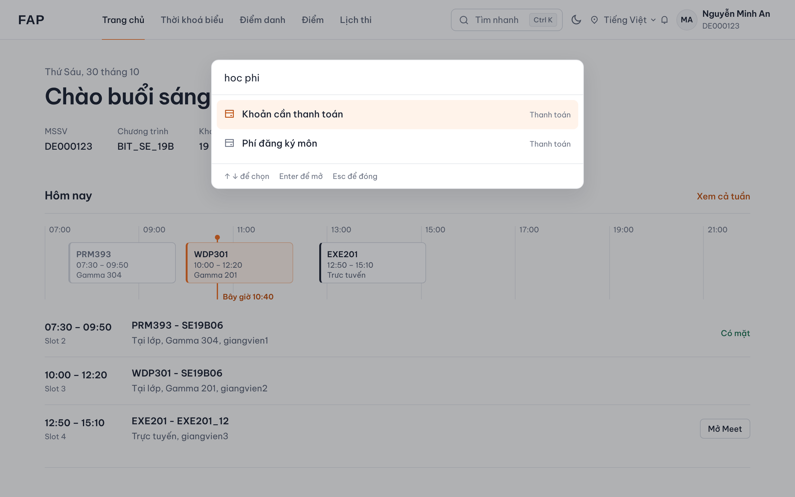
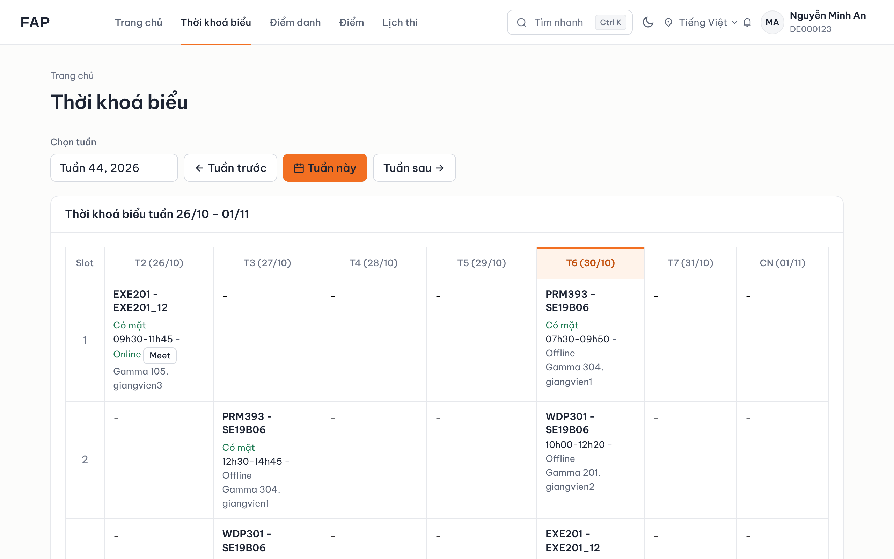
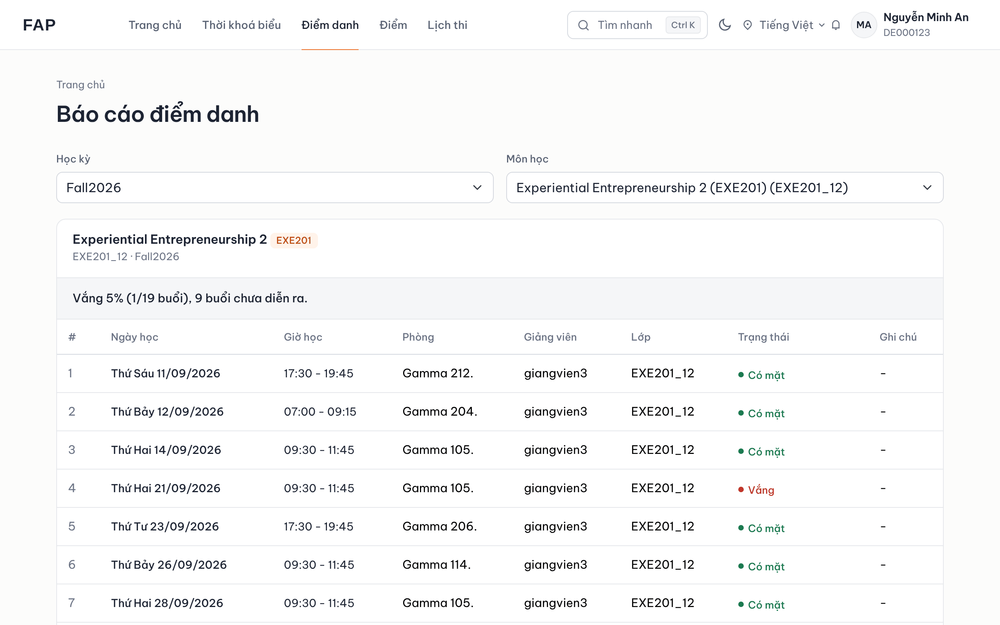
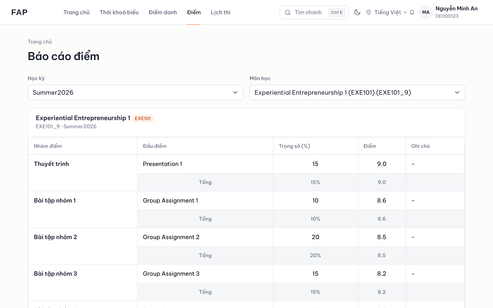
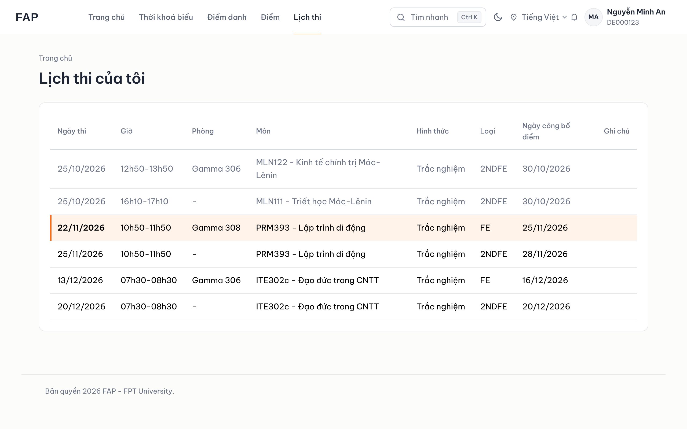
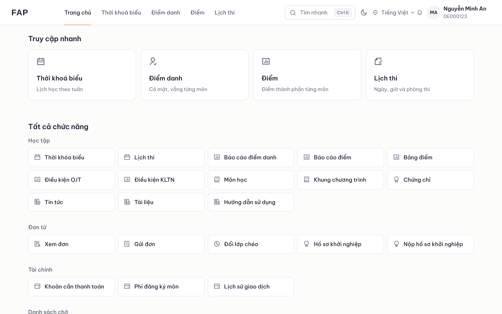
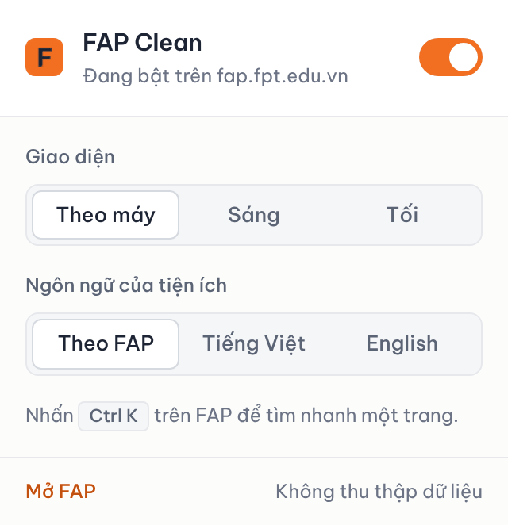

# FAP Clean

Tiện ích trình duyệt đổi giao diện [FAP](https://fap.fpt.edu.vn) sang kiểu tối giản: nền sáng thoáng, chữ rõ, viền mảnh, cam làm màu nhấn. Mọi dữ liệu vẫn lấy từ FAP, tiện ích chỉ thay cách trình bày.

Dùng được trên Chrome, Brave, Edge, Cốc Cốc và các trình duyệt nhân Chromium.

> Không chính thức. FAP Clean không liên kết và không được FPT Education hay Trường Đại học FPT xác nhận.



## Tính năng

**Trang chủ có lịch hôm nay.** Các buổi học nằm trên thanh thời gian, có vạch "Bây giờ" chạy theo giờ thật. Buổi đang học được tô cam, buổi đã qua làm mờ. Lớp trực tuyến có nút mở Google Meet. Hôm nào không có lớp thì hiện buổi học tiếp theo.

**Thanh điều hướng trên cùng** thay cho sidebar: Trang chủ, Thời khoá biểu, Điểm danh, Điểm, Lịch thi. Mọi chức năng khác của FAP nằm thành lưới ô ở trang chủ, chia theo nhóm, không phải mở menu con.

**Tìm nhanh `Ctrl K`** (macOS `⌘ K`). Gõ không dấu cũng được: `diem`, `lich thi`, `hoc phi`.

**Chế độ tối** tự theo máy, hoặc chọn Sáng/Tối bằng nút trên thanh trên cùng hay trong popup.

**Bảng gọn hơn.** Điểm danh và báo cáo điểm bỏ nền sọc, trạng thái có chấm màu. Lịch thi làm mờ buổi đã qua và đánh dấu buổi thi gần nhất.

| | |
|---|---|
|  |  |
| Chế độ tối | Tìm nhanh `Ctrl K` |
|  |  |
| Thời khoá biểu, cột hôm nay tô cam | Điểm danh có chấm trạng thái |
|  |  |
| Báo cáo điểm | Lịch thi, đánh dấu buổi gần nhất |
|  |  |
| Lưới tất cả chức năng | Popup bật/tắt và cài đặt |

Ảnh chụp dùng dữ liệu mẫu, không phải tài khoản thật.

## Cài đặt

1. Bấm nút xanh **Code** → **Download ZIP** ở đầu trang này, rồi giải nén.
2. Mở trang quản lý tiện ích:
   - Chrome: `chrome://extensions`
   - Brave: `brave://extensions`
   - Edge: `edge://extensions`
3. Bật **Developer mode** (Chế độ dành cho nhà phát triển).
4. Bấm **Load unpacked** (Tải tiện ích đã giải nén) và chọn thư mục vừa giải nén, tức thư mục có file `manifest.json`.
5. Mở hoặc tải lại https://fap.fpt.edu.vn.

**Cập nhật bản mới:** tải ZIP mới, chép đè vào thư mục cũ, rồi bấm nút tải lại ↻ của FAP Clean trong trang quản lý tiện ích.

**Tắt:** bấm biểu tượng FAP Clean trên thanh công cụ và gạt công tắc. FAP trở về y nguyên.

## Quyền riêng tư

- Chỉ chạy trên `https://fap.fpt.edu.vn/*`. Quyền duy nhất là `storage` để nhớ cài đặt.
- Không gửi dữ liệu ra ngoài: không có máy chủ, không quảng cáo, không theo dõi.
- Lịch hôm nay được đọc từ chính FAP (`/WeeklyTimetable/WeekPartial`), chỉ đọc, lưu tạm 10 phút trong tab.
- Font Be Vietnam Pro đóng gói sẵn, không tải từ máy chủ khác.

Chi tiết trong [PRIVACY.md](PRIVACY.md).

## Cấu trúc

```
manifest.json        Manifest V3
src/content.js       thanh điều hướng, trang chủ, tìm nhanh, chế độ tối
styles/fapx.css      toàn bộ giao diện; mọi quy tắc nằm dưới html.fapx
styles/fonts.css     khai báo font Be Vietnam Pro
popup/               popup bật/tắt và cài đặt
fonts/               Be Vietnam Pro (SIL Open Font License 1.1)
docs/                ảnh chụp cho README
```

Mọi CSS đều nằm dưới class `html.fapx`, và mọi phần tiện ích chèn vào trang đều mang class `fx-injected`. Vì vậy khi tắt, tiện ích gỡ sạch, không đè lên Bootstrap của FAP.

## Khi FAP thay đổi

Tiện ích dựa vào cấu trúc HTML hiện tại của FAP. Nếu trường cập nhật FAP và giao diện bị lệch, hãy tắt tiện ích trong popup để dùng giao diện gốc, rồi báo lỗi ở mục [Issues](../../issues).

## Giấy phép

Font Be Vietnam Pro theo [SIL Open Font License 1.1](fonts/OFL-LICENSE.txt).
